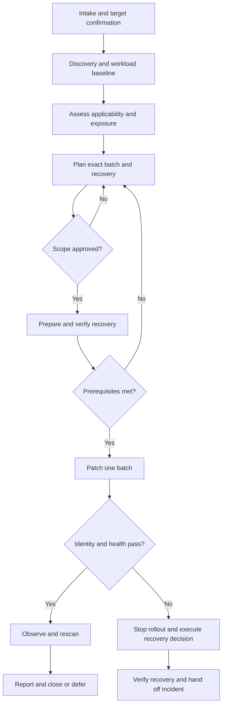

# HOWTO — the complete patching lifecycle

Use this procedure with the relevant [layer runbook](docs/WORKFLOWS.md). Commands are examples to adapt to a confirmed target, not a script to paste blindly into production.

## 1. Intake and ownership

Name the operator, service owner, approver, and recovery operator. One person can hold several roles, but record this. The agent assists; the service owner accepts workload risk.

Record target hostname/cloud ID, production or staging, OS release/architecture, topology, public exposure, application roots, dependencies, and a maintenance window with timezone. Identify whether the agent, SSH connection, monitoring, or backups depend on the target being restarted. Confirm out-of-band access before touching that dependency.

Fill [the plan template](templates/CHANGE_PLAN.md). Define allowed layers and explicit exclusions. Database migrations, firewall changes, package cleanup, and configuration refactors are separate scope unless required and approved.

## 2. Discover and establish baseline

```bash
bash scripts/audit.sh
```

The default audit performs local inspection. It does not refresh package indexes, scan every application, or establish vulnerability absence. Missing tools, access errors, and unsupported systems require follow-up.

Use explicit application roots. Optional npm scanning requires permission to contact the configured registry and possibly write npm logs/caches:

```bash
bash scripts/audit.sh --app-root /srv/api --network-scans
```

Review and redact hostnames, addresses, image names, dependency data, and paths before sharing. Never paste `.env`, credentials, full container inspection, raw Compose configuration, or unrestricted journals into chat.

Capture the [health contract](docs/RECOVERY.md): public and origin health, expected status/content, a critical functional request, dependency checks, and latency/error/resource baseline. Record pre-existing failed units and alerts. Resolve unexplained baseline failures before routine patching or document explicitly accepted degradation.

For redundant deployments, verify capacity, draining, routing, session/shared-state behavior, and version compatibility before claiming a rolling update avoids downtime. A single server may require interruption.

## 3. Assess applicability and prioritize

For each finding record exact installed version and source, advisory/scanner reference, timestamp, scanner database freshness, affected range, fixed version, exposure, and applicability. Distribution backports mean upstream version comparison alone is insufficient.

A pending apt update is not automatically a CVE; outdated Python packages are not automatically vulnerable; image age is not a vulnerability scan. Cross-reference verified CVEs against [CISA KEV](https://www.cisa.gov/known-exploited-vulnerabilities-catalog). KEV indicates known exploitation, not that this deployment is affected. Record failed lookups as unknown.

Prioritize applicable exploitation, exposure, impact, and recoverability. Select one layer or justify a coupled batch. There is no universal “apps before OS” ordering: an exploited host flaw may take precedence over an application dependency warning.

Record apt metadata freshness. The audit does not run `apt-get update`; a clean simulation against stale indexes is incomplete evidence. Metadata refresh is an authorized network and filesystem operation.

## 4. Plan and approve

Every change item must specify:

- Target, exact from/to version or artifact, and supporting finding.
- Commands, expected file/data effects, downloads, automatic restarts, and explicit restarts/reboots.
- Interruption estimate, health checks, observation interval, and abort thresholds.
- Backup/restore prerequisites, old artifact availability, rollback commands, recovery duration, and owner.

Approval identifies the plan revision, hosts, layer, window, maximum interruption, and allowed recovery action. It covers commands already listed; repeated approval for those same actions is unnecessary. Changed targets, unexpected removals, migrations, new services, or expanded downtime require an updated plan and approval.

Package maintainer scripts can restart services during installation. A gate before a later `systemctl restart` does not prevent this. Understand the distribution's behavior before starting; if the window forbids interruption and effects cannot be controlled, defer the installation.

## 5. Prepare recovery

Confirm working console/cloud access, retained old artifacts, available old package versions where relevant, configuration ownership/permissions, and disk/inode space. Coordinate unattended upgrades and other operators. Never delete package lock files or kill a transaction to get around contention.

Use application-consistent state backups. Snapshots may be crash-consistent or omit attached volumes. Confirm restore procedure, evidence of a restore rehearsal, recovery time (RTO), and accepted loss of writes (RPO). A copy that has never been restored is weak recovery evidence.

If recovery is unavailable or untested, stop routine execution. An owner-approved exception must identify affected items, downtime/data-loss exposure, and recovery limitations. “A backup probably exists” is insufficient.

## 6. Apply a bounded batch

Follow the [selected workflow](docs/WORKFLOWS.md). Capture UTC start/end, command, exit status, relevant redacted output, and artifact identity. In a redundant service, patch a canary, validate and observe it, then continue one instance at a time.

Stop on unexpected scope, transaction failure, storage pressure, lost access, invalid prerequisites, or health regression. Preserve evidence and use the planned recovery decision. Do not chain speculative fixes outside approval.

## 7. Verify and observe

Check installed artifact identity and running process identity, public endpoint and response content, critical functional flow, dependencies, error/latency behavior, and queued/scheduled work. Compare failed units with baseline rather than treating old failures as new regressions.

Check for processes using replaced libraries and pending reboot requirements with distribution-appropriate tools. Installation can succeed while vulnerable code remains active.

Repeat the applicable scanner with comparable scope. Advisory databases can change between scans, so a finding count need not decrease even when the targeted fix works. Report each targeted finding's disposition and scanner coverage/freshness.

Use the observation period and thresholds agreed before execution. A quick web request misses delayed jobs, rare traffic, and scheduled workers. Reboots truncate rate counters and monitoring windows; do not mistake gaps for improvement.

## 8. Close or hand off

Complete [the report](templates/CHANGE_REPORT.md). Distinguish installed, activated, health-verified, and security-verified changes. Mark unrun tests and failed scans explicitly. Record measured downtime and remaining uncertainty.

Deferred items need an owner, deadline, exposure, and compensating control. Keep evidence access-controlled with a retention policy. A scheduled inventory job does not authorize unattended production patching.

## Lifecycle and stop paths


